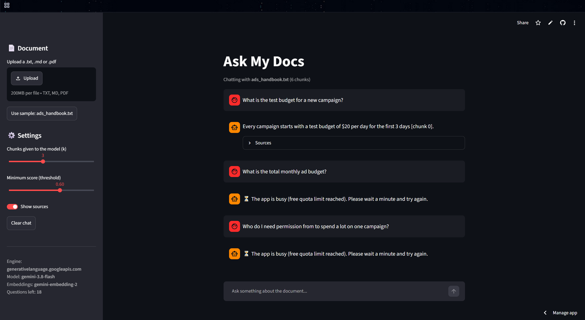

# Ask My Docs

**Live demo: https://ai-learning-phyxerdev.streamlit.app/** ← replace with your link

Upload a document (.txt, .md or .pdf) and ask questions about it. Answers come **only** from the document, with the source chunk cited, and the app says *"That isn't covered in the document"* instead of guessing.



Built in 14 days as an AI/LLM learning project: local models first (Ollama), then deployed on a free cloud model.

## How it works (RAG)

```
Upload ─▶ split into chunks ─▶ embed each chunk (text → numbers that capture meaning)

Question ─▶ embed ─▶ find the 3 most similar chunks ─▶ best score too low? ─▶ "not covered"
                                       │
                                       ▼
                 LLM: "answer ONLY from these chunks, cite them" ─▶ streamed answer + sources
```

Two safety filters stop made-up answers:
1. **Score threshold** – if no chunk is similar enough, the LLM is never called.
2. **Prompt rule** – if the chunks don't contain the answer, the LLM must say so.

## Run it locally (free, private)

```bash
pip install -r requirements.txt
ollama pull qwen3:8b
ollama pull nomic-embed-text
copy .env.example .env          # Mac/Linux: cp .env.example .env
python -m streamlit run app.py
```

## Switch engines without changing code

All engines are called through the OpenAI-compatible API, so switching = editing `.env` (or Streamlit Secrets online):

| Engine | Where it runs | Cost |
| --- | --- | --- |
| Ollama (Qwen3, Llama, GLM-4 9B…) | Your own PC | Free |
| Gemini | Google cloud | Free tier |
| GLM 5.x | Z.ai cloud | Paid |

See `.env.example` for every setting. `python list_models.py` shows the model names your key can use, and `python compare_engines.py` tests every engine on the same questions.

> When you change the embedding model, re-measure `RAG_MIN_SCORE` – similarity scores differ between models.

## Deploy your own copy

1. Fork this repo.
2. On [share.streamlit.io](https://share.streamlit.io): **Create app** → this repo → `app.py`.
3. Paste your settings into **Secrets** (same names as in `.env.example`).

Built-in limits for public use: questions per session, file size, chunks per document, answer length, optional password.

## Files

| File | What it does |
| --- | --- |
| `app.py` | The Streamlit web app |
| `rag.py` | Load → chunk → embed → search → answer |
| `llm.py` | One client for every engine |
| `compare_engines.py` | Same questions on every engine → `compare_report.md` |
| `list_models.py` | Lists model names for the current engine |
| `explainer.py` | Mini project 1: Facebook Ads CSV explainer |
| `day8_agent.py` | Tool-using agent (calculator, domain check, time) |
| `day10_embeddings.py` | Embeddings and chunking experiments |
| `day11_ask.py` | Command-line version of Ask My Docs |